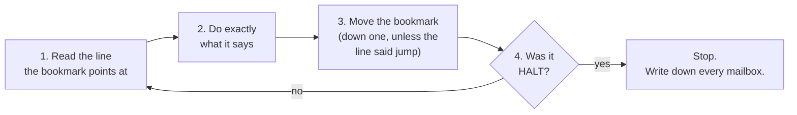

# How a benchmark runs (ELI5)

This tutorial follows one small program from its starting memory to its
finished memory, step by step. Everything here uses real files in this folder,
so you can open each one and check it as you go.

---

## 1. The machine is three things

Imagine a very obedient clerk at a desk.

| Part | The clerk's version | In our ISA |
| --- | --- | --- |
| **Memory** | A long row of numbered mailboxes. Each holds one small number (one byte). | Data memory, addresses 0x0000000 and up |
| **Registers** | 16 sticky notes on the desk, R0 to R15. The clerk can only do math on sticky notes, never directly on mailboxes. | R0-R15 (and F0-F15 for decimals) |
| **PC** | A bookmark in the instruction list, saying which line to do next. | The program counter |

The clerk can't think. It can only repeat four steps, forever:



That loop *is* "running assembly." There is nothing else to it. The program is
a list of lines, and the PC walks through it.

The only line types that move the bookmark anywhere except "down one" are
branches (`BEQ`, `BNE`, `BGE`, ...: "jump **if** something is true") and
jumps (`J`, `JAL`, `JR`: "jump, no questions asked"). That is how loops happen:
a line near the bottom says "go back up to line 7."

---

## 2. Reading a `.mem` file

Open `tutorial/tiny.mem`. The top looks like this:

```
# tiny - a 4-element array for the tutorial: 7, -3, 42, 19
28,8
0000000,00
0000001,00
0000002,00
0000003,04
```

- **Line 1** is a comment, just a name.
- **Line 2**, `28,8`, means addresses are 28 bits long and each mailbox holds
  8 bits (one byte).
- **Every other line** is `mailbox number,what's in it`, both written in hex.

**Hex in 30 seconds:** hex counts to 15 in one digit (`0-9` then `A B C D E F`),
so each place is worth 16. `0x` in front just means "this is hex."
`04` = 4. `2A` = 2×16 + 10 = 42. `13` = 1×16 + 3 = 19.

**Four mailboxes make one number.** Our numbers are 32 bits, and one mailbox is
8 bits, so each number fills four mailboxes in a row, biggest part first. Read
the four values left to right as one hex number:

| Mailboxes | Contents | Glued together | Means |
| --- | --- | --- | --- |
| 0, 1, 2, 3 | `00 00 00 04` | `0x00000004` | 4, the array length N |
| 8, 9, A, B | `00 00 00 07` | `0x00000007` | 7, the first element |
| C, D, E, F | `FF FF FF FD` | `0xFFFFFFFD` | -3 (see below) |
| 10-13 | `00 00 00 2A` | `0x0000002A` | 42 |
| 14-17 | `00 00 00 13` | `0x00000013` | 19 |

**Negative numbers** start with lots of `F`s. `0xFFFFFFFF` is -1, and you count
down from there: `...FE` is -2 and `...FD` is -3. (This is "two's complement."
You don't need the math today; just recognize the pattern.)

**Mailboxes 4-7 aren't listed.** Unlisted mailboxes hold 0. That's the empty
slot where the program will write its answer.

---

## 3. `.mem` vs `.mem.expected`: before and after

- **`.mem`** is a photo of the mailboxes **before** the program runs.
- **`.mem.expected`** is a photo of what the mailboxes **should** look like
  **after** a correct run. It's the answer key.
- **`.mem.out`** (made later by your simulator) is a photo of what the
  mailboxes **actually** look like after the run.

Grading is just: does `.mem.out` match `.mem.expected`?

For MAXFINDER, the two photos are almost identical. The program only writes one
number, so `diff` shows only those four lines:

```
$ diff tutorial/tiny.mem tutorial/tiny.mem.out
> 0000004,00
> 0000005,00
> 0000006,00
> 0000007,2A
```

`0x0000002A` = 42 landed in mailboxes 4-7. 42 is the biggest of 7, -3, 42, 19.
Everything else in both files is the same, line for line.

The real ISAbench pairs work the same way. Try
`diff ISAbench/maxFinderInt.mem ISAbench/maxFinderInt.mem.expected` and you'll
see `0x00001CAD` = 7341, the largest number in that array.

---

## 4. Watch it run

Here's the clerk running `ISAbench/maxFinderInt.asm` on `tutorial/tiny.mem`,
one line per instruction. This is real output from `trace.py`:

```
step   PC  instruction              what it did
   1    0  LW    R1, 0(R0)          R1 = 4
   2    1  BGE   R0, R1, 12         condition false: go on to the next line
   3    2  ADDI  R2, R0, 8          R2 = 8
   4    3  ADDI  R7, R0, 2          R7 = 2
   5    4  SLL   R6, R1, R7         R6 = 16
   6    5  ADD   R6, R6, R2         R6 = 24
   7    6  LW    R3, 0(R2)          R3 = 7
   8    7  ADDI  R2, R2, 4          R2 = 12
   9    8  BGEU  R2, R6, 4          condition false: go on to the next line
  10    9  LW    R5, 0(R2)          R5 = -3
  11   10  BGE   R3, R5, -4         condition true: jump to 7
  12    7  ADDI  R2, R2, 4          R2 = 16
  13    8  BGEU  R2, R6, 4          condition false: go on to the next line
  14    9  LW    R5, 0(R2)          R5 = 42
  15   10  BGE   R3, R5, -4         condition false: go on to the next line
  16   11  ADDI  R3, R5, 0          R3 = 42
  17   12  J     7                  jump to 7
  18    7  ADDI  R2, R2, 4          R2 = 20
  19    8  BGEU  R2, R6, 4          condition false: go on to the next line
  20    9  LW    R5, 0(R2)          R5 = 19
  21   10  BGE   R3, R5, -4         condition true: jump to 7
  22    7  ADDI  R2, R2, 4          R2 = 24
  23    8  BGEU  R2, R6, 4          condition true: jump to 13
  24   13  SW    R3, 4(R0)          memory word at 0x004 = 42
  25   14  HALT                     stop
```

In plain English, the program has three phases:

**Setup (steps 1-7).**
- Step 1: `LW R1, 0(R0)` means "load the number at mailbox 0 into R1." So R1 = 4
  elements. (R0 is always 0, so `0(R0)` just means mailbox 0.)
- Step 2: if N ≤ 0 there's nothing to do. Not the case, so keep going.
- Steps 3-6: R2 = 8 is the **pointer**, the mailbox of the current element.
  R6 = 8 + 4×4 = 24 is the mailbox **just past** the end of the array. When R2
  reaches 24, we're done.
- Step 7: R3 = 7. "The biggest so far" starts as the first element.

**The loop (steps 8-23).** PC goes 7 → 8 → 9 → 10, then back to 7. Each lap:
1. Move the pointer to the next element (R2 goes up by 4, one number).
2. If the pointer reached the end, leave the loop.
3. Load the element into R5.
4. If biggest-so-far ≥ this element, skip it (jump back to 7).
5. Otherwise R3 = this element, then jump back to 7.

Watch R3 change: it starts at 7, ignores -3 (step 11), takes 42 (step 16),
and ignores 19 (step 21).

**Finish (steps 24-25).** `SW R3, 4(R0)` means "store R3 into mailbox 4." That
single line is the entire difference between `.mem` and `.mem.out`. Then
`HALT`.

### Where the numbers in a branch come from

`BGE R3, R5, -4` at line 10 says "if R3 ≥ R5, jump back 4 lines, counting from
the line after me." The line after is 11, and 11 - 4 = 7. In the source file
(`src/maxFinderInt.s`) it's written `BGE R3, R5, LOOP`,
which is easier for people. The build replaced `LOOP` with `-4`, because the
handout says the submitted files can't contain labels. The `.asm` comment keeps
the name: `[LOOP = address 7]`.

---

## 5. Tracing one `testAll` line into `.mem.expected`

`testAll` is the same idea, with lots of tiny tests instead of one loop. Pick
any store line with an `M[...] = ...` comment in
`ISAbench/testAll.asm`:

```
    ADD   R6, R1, R2          #   7:
    SW    R6, 0x04(R13)       #   8: M[0x104] = 0xFFFFFFF2
```

1. Line 7 adds R1 and R2 (loaded earlier from `testAll.mem`: -20 and 6) into R6.
   Result: -14.
2. Line 8 stores R6 at R13 + 4. R13 was set to 0x100 at line 4, so that's
   mailbox **0x104**. The comment `M[0x104] = 0xFFFFFFF2` says which mailbox
   and what should land there (-14 as hex). `M[...]` is the spec's RTL
   notation for memory.
3. Open `ISAbench/testAll.mem.expected` and find mailboxes 104-107:
```
   0000104,FF
   0000105,FF
   0000106,FF
   0000107,F2
```
   Glued together: `0xFFFFFFF2`. That's the test passing.

If someone's simulator got ADD wrong, those four lines would be different in
their `.mem.out`, and `diff` would point straight at mailbox 0x104, which is
the ADD test. That's why each test gets its own mailbox.

---

## 6. So who actually runs the `.asm` file?

**Nobody, yet.** No real chip understands our ISA, because our team invented
it. The `.asm` file is just text. The thing that plays the clerk is the
**simulator**, which is the Oct 19 deliverable. It's a program (in Python, Java,
C, whatever) that:

1. reads the `.asm` lines and the `.mem` file,
2. runs the four-step loop from section 1,
3. writes `.mem.out` at HALT, plus the instruction counts.

For now, `isaref.py` plays the clerk. It's how the
`.mem.expected` files were made. `trace.py` is the same clerk
narrating each step, which is close to what the simulator's required `-s`
step mode has to show.

---

## 7. Try it yourself

From this `benchmarks` folder:

```
python trace.py ISAbench/maxFinderInt.asm tutorial/tiny.mem
python trace.py ISAbench/maxFinderFP.asm ISAbench/maxFinderFPNeg.mem
python trace.py ISAbench/testAll.asm ISAbench/testAll.mem
```

To experiment, copy `tutorial/tiny.mem`, change a number (for example, make the
`2A` in mailbox 13 a `01`), and trace it again. R3 should end on 19 instead.

**Don't put experiment files in `ISAbench/`.** The onyx `submit` command grabs
everything in that folder.
